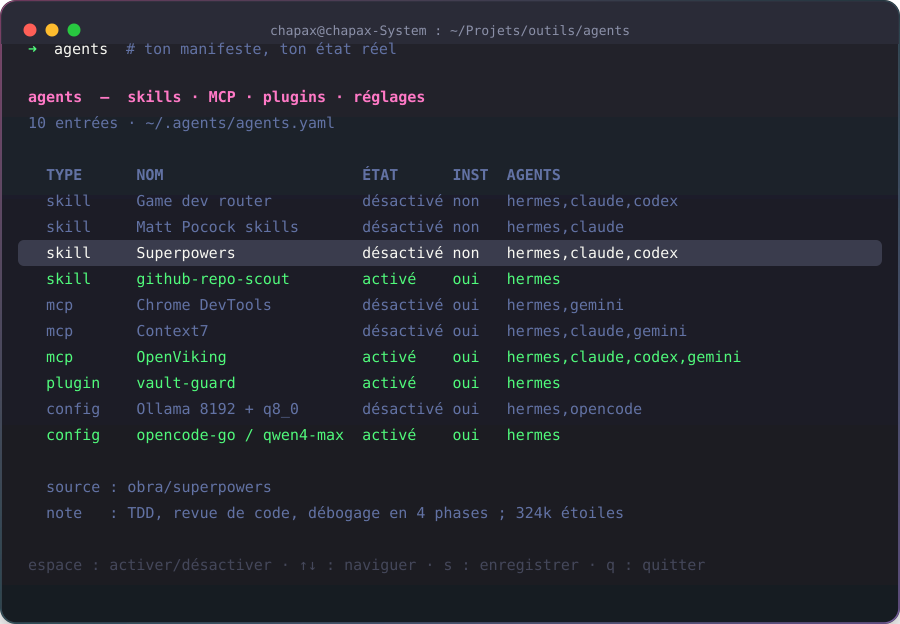

<div align="center">



<br>

**Un seul manifeste pour les skills, serveurs MCP, plugins et réglages de tes agents.**

</div>

---

## Le problème

Un skill installé pour Hermes et absent pour Codex ne se voit nulle part.
Un serveur MCP déclaré dans quatre fichiers dont deux sont orphelins non plus.

```
MANQUANT  skill  Superpowers  agent=codex  ~/.codex/skills/superpowers
```

## Installation

```sh
curl -fsSL https://raw.githubusercontent.com/Chapax/agents/main/install.sh | sh
```

Binaire dans `~/.local/bin`. Pas de `sudo`, pas de dépendance.

Depuis les sources (Go 1.24+) :

```sh
git clone https://github.com/Chapax/agents.git
cd agents && go build -o ~/.local/bin/agents .
```

## Usage

```sh
agents --init     # crée ~/.agents/agents.yaml
agents            # interface
agents --json     # état structuré
agents --check    # code 1 si une entrée activée manque
```

| Touche | Action |
|---|---|
| `↑` `↓` · `j` `k` | naviguer |
| `espace` · `entrée` | activer / désactiver |
| clic | activer / désactiver la ligne |
| `s` | enregistrer |
| `q` | quitter |

Le manifeste est cherché en remontant depuis le dossier courant, puis dans
`~/.agents/agents.yaml`.

## Manifeste

Une entrée décrit une chose et son emplacement par agent :

```yaml
- id: superpowers
  kind: skill              # skill | mcp | plugin | config
  name: Superpowers
  source: obra/superpowers
  enabled: true
  agents: [hermes, claude, codex]
  targets:
    hermes: ~/.hermes/skills/superpowers
    claude: ~/.claude/skills/superpowers
    codex:  ~/.codex/skills/superpowers
```

### Emplacements reconnus

| Agent | Configuration | Skills | MCP |
|---|---|---|---|
| Hermes | `~/.hermes/config.yaml` | `~/.hermes/skills` | `~/.hermes/config.yaml` |
| Claude Code | `~/.claude/settings.json` | `~/.claude/skills` | `~/.claude.json` |
| Codex | `~/.codex/config.toml` | `~/.codex/skills` | `~/.codex/config.toml` |
| Gemini / Antigravity | `~/.gemini/settings.json` | — | `~/.gemini/config/mcp_config.json` |
| opencode | `~/.config/opencode/opencode.json` | — | — |
| Cursor | `~/.cursor/hooks.json` | — | — |

Hermes garde ses profils séparés (`~/.hermes/profiles/<nom>/`).

## Portée

- l'outil **écrit le manifeste**, il n'installe pas les skills à ta place
- il ne modifie la configuration d'aucun autre outil
- il ne télécharge rien sans demande explicite

## Licence

[MIT](LICENSE)
